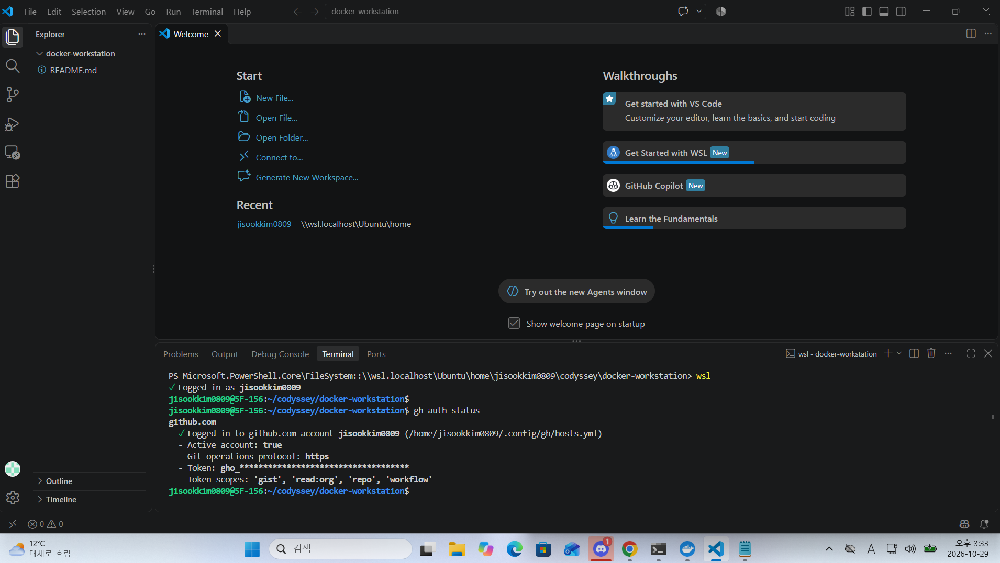
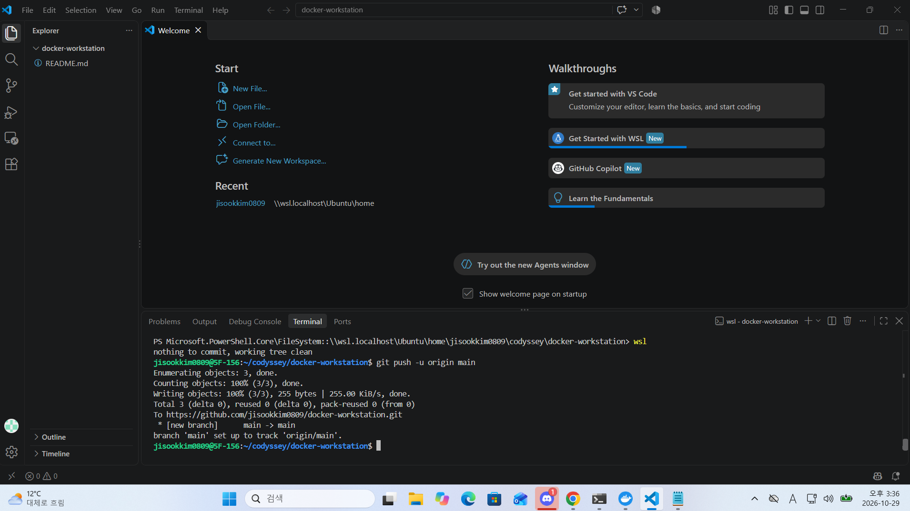
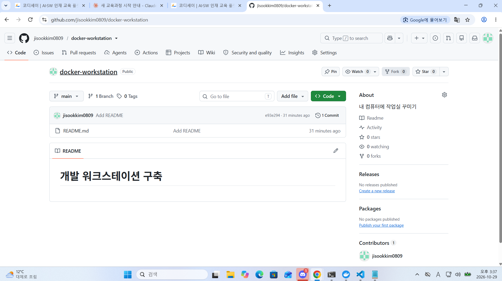
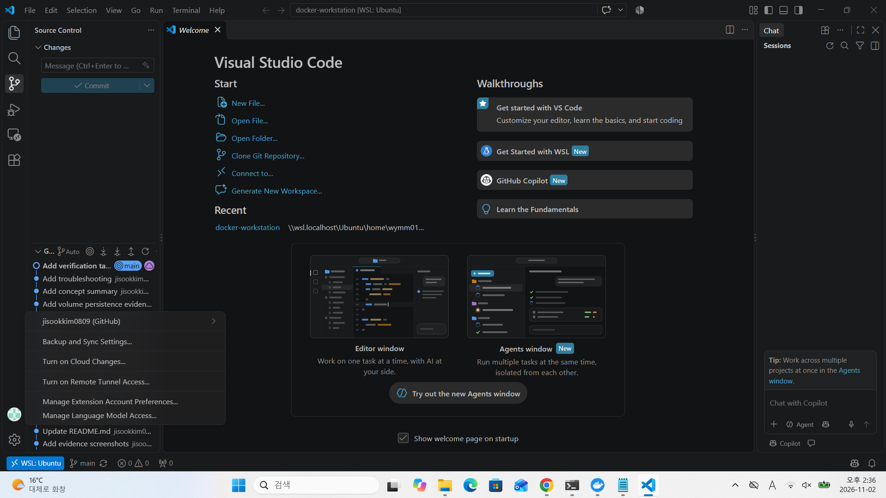
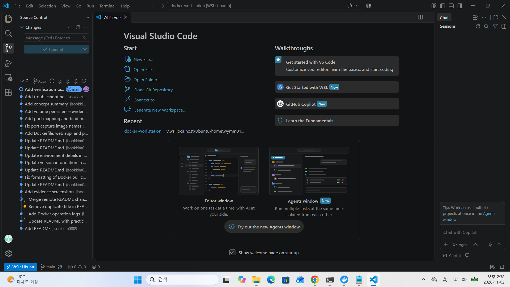
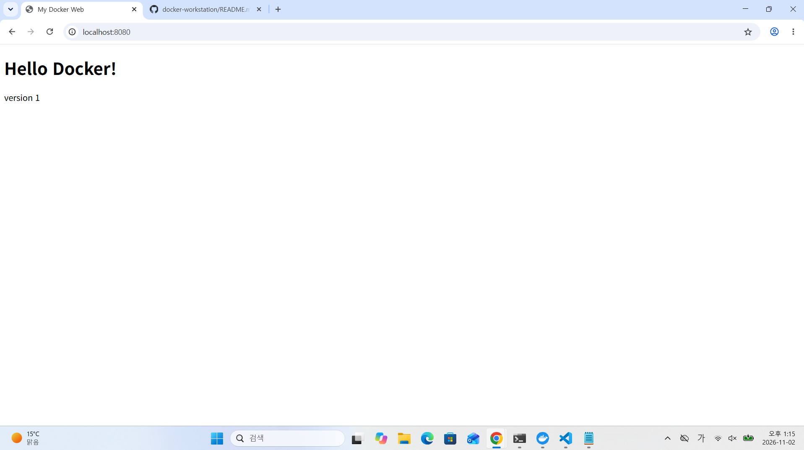
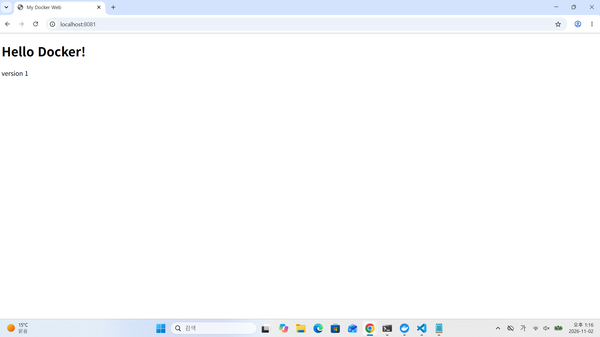

# 개발 워크스테이션 구축
 터미널(리눅스 CLI), Docker, Git/GitHub을 직접 세팅하고 검증한 기록입니다.
=======


## 1) 프로젝트 개요

- 목표: 터미널로 작업 환경을 정리하고, Docker로 웹 서버를 컨테이너화하여 포트 매핑·바인드 마운트·볼륨을 검증하고, Git/GitHub으로 결과물을 관리한다.
- 핵심 확인 사항: 이미지와 컨테이너의 분리, 격리된 실행 환경, 포트·스토리지 연결 방식

## 2) 실행 환경

| 항목 | 내용 |
|---|---|
| OS | Windows + WSL Ubuntu 26.04.1 LTS |
| Shell / Terminal | bash / Ubuntu 터미널 (WSL) |
| Docker | 29.9.2 |
| Git | 2.53.0 |

```bash
$ lsb_release -d
Description:    Ubuntu 26.04.1 LTS

$ docker --version
Docker version 29.9.2, build a82e528

$ git --version
git version 2.53.0
```

## 3) 수행 체크리스트

- [x] Git 사용자 정보/기본 브랜치 설정
- [x] GitHub 저장소 생성 및 `gh` 로그인, push 연동
- [x] 터미널 기본 조작 (이동/생성/복사/이름변경/이동/삭제)
- [x] 권한 변경 실습 (파일 1개, 디렉토리 1개)
- [x] Docker 설치/점검 (`docker --version`, `docker info`)
- [x] Docker 기본 운영 명령 (images, ps, logs, stats)
- [x] hello-world / ubuntu 컨테이너 실행
- [x] Dockerfile 기반 커스텀 이미지 빌드/실행
- [x] 포트 매핑 접속 (8080, 8081)
- [x] 바인드 마운트 반영 확인
- [x] 볼륨 영속성 검증
- [x] VS Code GitHub 연동 증거

## 검증 방법 요약

| 항목 | 사용한 명령 | 확인한 것 | 결과 위치 |
|---|---|---|---|
| 터미널 기본 조작 | `pwd`, `ls -la`, `mkdir`, `cp`, `mv`, `rm`, `cat` | 파일/폴더 생성·복사·이동·삭제 결과 | 4-3 |
| 권한 변경 | `ls -l`, `ls -ld`, `chmod 600/700/755/644` | 변경 전/후 권한 문자열 비교 | 4-4 |
| Docker 설치/점검 | `docker --version`, `docker info` | 클라이언트·엔진(Server Version) 동작 | 4-5 |
| Docker 기본 운영 | `docker pull/images/ps/logs/stats/stop/rm` | 이미지·컨테이너 상태, 로그, 자원 사용량 | 4-6 |
| 컨테이너 실행 | `docker run hello-world`, `docker run -it ubuntu bash` | hello-world 출력, 컨테이너 내부 명령 실행 | 4-7 |
| attach vs exec | `docker exec`, `docker attach`, `docker ps` | exit 후 컨테이너 유지/종료 차이 | 4-7 |
| 커스텀 이미지 | `docker build -t my-web:1.0 .` | 빌드 성공, 이미지 생성 | 4-8 |
| 포트 매핑 | `docker run -p 8080:80`, `-p 8081:80`, `curl` | 호스트 포트로 접속 시 응답, 브라우저 화면 | 4-9 |
| 바인드 마운트 | `docker run -v ...`, `sed`, `curl` | 호스트 파일 수정이 컨테이너에 즉시 반영 | 4-10 |
| 볼륨 영속성 | `docker volume create`, `docker run -v mydata:/data` | 컨테이너 삭제 후에도 데이터 유지 | 4-11 |
| Git 설정 | `git config --list` | 사용자 이름·이메일·기본 브랜치 | 4-1 |
| GitHub 연동 | `gh auth status`, `git push` | 로그인 상태, 원격 저장소로 push 성공 | 4-2 |

## 재현 방법 및 주의사항

- 환경: Windows + WSL(Ubuntu), Docker Desktop(WSL integration에서 Ubuntu 활성화), Git, GitHub CLI(`gh`)
- 실행 전: Docker Desktop이 켜져 있어야 하고, `docker --version`과 `docker info`가 정상이어야 한다.
- 실행 순서: 저장소를 받은 뒤 `docker-workstation` 폴더에서 `docker build -t my-web:1.0 .` → `docker run -d -p 8080:80 --name my-web-8080 my-web:1.0` → `curl http://localhost:8080` 순서로 따라 하면 4-8, 4-9를 재현할 수 있다.
- 작업 컴퓨터: 학원 PC 2대를 사용했다(5F-156 사용자 jisookkim0809, 5F-158 사용자 wymm01). 터미널 프롬프트의 사용자명은 컴퓨터마다 다르며, GitHub 계정은 두 곳 모두 jisookkim0809이다.
- 포트: 8080, 8081, 8082를 사용했다. 이미 사용 중이면 다른 포트로 바꿔 실행한다.

## 4) 수행 로그 및 검증

### 4-1. Git 설정

```bash
$ git --version
git version 2.53.0

$ git config --global init.defaultBranch main
$ git config --list
init.defaultbranch=main
remote.origin.url=https://github.com/jisookkim0809/docker-workstation.git
branch.main.remote=origin
branch.main.merge=refs/heads/main
user.name=jisookkim0809
user.email=jisookkim0809@gmail.com
```

### 4-2. GitHub 로그인 및 저장소 연동

```bash
$ gh auth status
github.com
  ✓ Logged in to github.com account jisookkim0809 (/home/jisookkim0809/.config/gh/hosts.yml)
  - Active account: true
  - Git operations protocol: https
  - Token: gho_************************************
  - Token scopes: 'gist', 'read:org', 'repo', 'workflow'

$ git push -u origin main
Enumerating objects: 3, done.
Counting objects: 100% (3/3), done.
Writing objects: 100% (3/3), 255 bytes | 255.00 KiB/s, done.
Total 3 (delta 0), reused 0 (delta 0), pack-reused 0 (from 0)
To https://github.com/jisookkim0809/docker-workstation.git
 * [new branch]      main -> main
branch 'main' set up to track 'origin/main'.
```

- 증거 이미지:







### 4-3. 터미널 기본 조작 로그

```bash
$ cd ~/codyssey/practice
$ pwd
/home/jisookkim0809/codyssey/practice

$ ls -la
total 16
drwxr-xr-x 3 jisookkim0809 jisookkim0809 4096 Oct 29 15:58 .
drwxr-xr-x 4 jisookkim0809 jisookkim0809 4096 Oct 29 15:47 ..
-rw-r--r-- 1 jisookkim0809 jisookkim0809    6 Oct 29 15:50 a.txt
-rw-r--r-- 1 jisookkim0809 jisookkim0809    0 Oct 29 15:49 empty.txt
drwxr-xr-x 2 jisookkim0809 jisookkim0809 4096 Oct 29 15:58 testdir

$ touch empty.txt
$ echo "hello" > a.txt
$ ls
a.txt  empty.txt  testdir

$ cat a.txt
hello

$ cp a.txt b.txt
$ ls
a.txt  b.txt  empty.txt  testdir

$ mv b.txt c.txt
$ mkdir dir1
$ mv c.txt dir1/
$ ls dir1
c.txt

$ rm dir1/c.txt
$ rmdir dir1
$ ls
a.txt  empty.txt  testdir
```

### 4-4. 권한 실습 (변경 전/후)

파일:

```bash
$ ls -l a.txt
-rw-r--r-- 1 jisookkim0809 jisookkim0809 6 Oct 29 15:50 a.txt

$ chmod 600 a.txt
$ ls -l a.txt
-rw------- 1 jisookkim0809 jisookkim0809 6 Oct 29 15:50 a.txt

$ chmod 644 a.txt
$ ls -l a.txt
-rw-r--r-- 1 jisookkim0809 jisookkim0809 6 Oct 29 15:50 a.txt
```

디렉토리:

```bash
$ chmod 755 testdir
$ ls -ld testdir
drwxr-xr-x 2 jisookkim0809 jisookkim0809 4096 Oct 29 15:58 testdir

$ chmod 700 testdir
$ ls -ld testdir
drwx------ 2 jisookkim0809 jisookkim0809 4096 Oct 29 15:58 testdir

$ chmod 755 testdir
$ ls -ld testdir
drwxr-xr-x 2 jisookkim0809 jisookkim0809 4096 Oct 29 15:58 testdir
```

### 4-5. Docker 설치 및 점검

```bash
$ docker --version
Docker version 29.9.2, build a82e528

$ docker info | grep -i "server version"
 Server Version: 29.9.2
```

### 4-6. Docker 기본 운영 명령

```bash
$ docker pull nginx:alpine
alpine: Pulling from library/nginx
b9b388a21ecf: Pull complete 
7b229517ed22: Pull complete 
26185d08a3ec: Pull complete 
12b85cff06fd: Pull complete 
7cc330898115: Pull complete 
657023555a2a: Pull complete 
2ec5fb117ffa: Pull complete 
9b0f7dfe35b2: Pull complete 
a4d5b1f57abc: Download complete 
acc2d54c3743: Download complete 
Digest: sha256:785835ea65db4bba6f021acc0f3be91b0fef76a53fe41f8588c6698d2aed0606
Status: Downloaded newer image for nginx:alpine
docker.io/library/nginx:alpine

$ docker images
                                                       i Info →   U  In Use
IMAGE                ID             DISK USAGE   CONTENT SIZE   EXTRA
hello-world:latest   c567b231f656       25.9kB         9.49kB    U   
nginx:alpine         785835ea65db       94.5MB         27.2MB        
ubuntu:latest        6a06111c3b0a        163MB         45.9MB    U   

$ docker run -d --name web nginx:alpine
88e4c7574ee2f750387e0537682931704796384673909341d7bea65c9df18f57

$ docker ps
CONTAINER ID   IMAGE          COMMAND                  CREATED                  STATUS                  PORTS     NAMES
88e4c7574ee2   nginx:alpine   "/docker-entrypoint.…"   Less than a second ago   Up Less than a second   80/tcp    web

$ docker logs web
/docker-entrypoint.sh: /docker-entrypoint.d/ is not empty, will attempt to perform configuration
/docker-entrypoint.sh: Looking for shell scripts in /docker-entrypoint.d/
/docker-entrypoint.sh: Launching /docker-entrypoint.d/10-listen-on-ipv6-by-default.sh
10-listen-on-ipv6-by-default.sh: info: Getting the checksum of /etc/nginx/conf.d/default.conf
10-listen-on-ipv6-by-default.sh: info: Enabled listen on IPv6 in /etc/nginx/conf.d/default.conf
/docker-entrypoint.sh: Sourcing /docker-entrypoint.d/15-local-resolvers.envsh
/docker-entrypoint.sh: Launching /docker-entrypoint.d/20-envsubst-on-templates.sh
/docker-entrypoint.sh: Launching /docker-entrypoint.d/30-tune-worker-processes.sh
/docker-entrypoint.sh: Configuration complete; ready for start up
2026/10/29 12:15:34 [notice] 1#1: using the "epoll" event method
2026/10/29 12:15:34 [notice] 1#1: nginx/1.31.8
2026/10/29 12:15:34 [notice] 1#1: built by gcc 15.2.0 (Alpine 15.2.0) 
2026/10/29 12:15:34 [notice] 1#1: OS: Linux 6.18.54.1-microsoft-standard-WSL2
2026/10/29 12:15:34 [notice] 1#1: getrlimit(RLIMIT_NOFILE): 1048576:1048576
2026/10/29 12:15:34 [notice] 1#1: start worker processes
2026/10/29 12:15:34 [notice] 1#1: start worker process 30
2026/10/29 12:15:34 [notice] 1#1: start worker process 31
2026/10/29 12:15:34 [notice] 1#1: start worker process 32
2026/10/29 12:15:34 [notice] 1#1: start worker process 33
2026/10/29 12:15:34 [notice] 1#1: start worker process 34
2026/10/29 12:15:34 [notice] 1#1: start worker process 35
2026/10/29 12:15:34 [notice] 1#1: start worker process 36
2026/10/29 12:15:34 [notice] 1#1: start worker process 37

$ docker stats --no-stream
CONTAINER ID   NAME      CPU %     MEM USAGE / LIMIT     MEM %     NET I/O      BLOCK I/O     PIDS
88e4c7574ee2   web       0.00%     8.508MiB / 7.625GiB   0.11%     690B / 84B   0B / 8.19kB   9

$ docker stop web
web

$ docker rm web
web

$ docker ps -a
CONTAINER ID   IMAGE         COMMAND    CREATED          STATUS                      PORTS     NAMES
0b473335d3ad   ubuntu        "bash"     8 minutes ago    Exited (0) 7 minutes ago              my-ubuntu
e2eb6ce9947d   hello-world   "/hello"   48 minutes ago   Exited (0) 48 minutes ago             dazzling_jackson
```

### 4-7. 컨테이너 실행 실습

```bash
$ docker run hello-world
Unable to find image 'hello-world:latest' locally
latest: Pulling from library/hello-world
4f55086f7dd0: Pull complete 
d5e71e642bf5: Download complete 
Digest: sha256:c567b231f65614688711a75f31518a064258a51d442117a3e771a3a8fdba78ef
Status: Downloaded newer image for hello-world:latest

Hello from Docker!
This message shows that your installation appears to be working correctly.

To generate this message, Docker took the following steps:
 1. The Docker client contacted the Docker daemon.
 2. The Docker daemon pulled the "hello-world" image from the Docker Hub.
    (amd64)
 3. The Docker daemon created a new container from that image which runs the
    executable that produces the output you are currently reading.
 4. The Docker daemon streamed that output to the Docker client, which sent it
    to your terminal.

To try something more ambitious, you can run an Ubuntu container with:
 $ docker run -it ubuntu bash

Share images, automate workflows, and more with a free Docker ID:
 https://hub.docker.com/

For more examples and ideas, visit:
 https://docs.docker.com/get-started/

$ docker run -it --name my-ubuntu ubuntu bash
(이미지 내려받기 로그 중략)
Digest: sha256:6a06111c3b0a8600feadb270aec771dc239bf407b25625f93f44ab00e11f4d3c
Status: Downloaded newer image for ubuntu:latest
root@0b473335d3ad:/# ls
bin   etc   lib64  opt   run   sys  var
boot  home  media  proc  sbin  tmp
dev   lib   mnt    root  srv   usr
root@0b473335d3ad:/# echo "hi from container"
hi from container
root@0b473335d3ad:/# exit
exit

$ docker start my-ubuntu
my-ubuntu

$ docker exec -it my-ubuntu bash
root@0b473335d3ad:/# echo "hi from exec"
hi from exec
root@0b473335d3ad:/# exit
exit

$ docker ps
CONTAINER ID   IMAGE     COMMAND   CREATED          STATUS          PORTS     NAMES
0b473335d3ad   ubuntu    "bash"    12 minutes ago   Up 31 seconds             my-ubuntu

$ docker attach my-ubuntu
root@0b473335d3ad:/# echo "hi from attach"
hi from attach
root@0b473335d3ad:/# exit
exit

$ docker ps
CONTAINER ID   IMAGE     COMMAND   CREATED   STATUS    PORTS     NAMES

$ docker ps -a
CONTAINER ID   IMAGE         COMMAND    CREATED          STATUS                      PORTS     NAMES
0b473335d3ad   ubuntu        "bash"     13 minutes ago   Exited (0) 12 seconds ago             my-ubuntu
e2eb6ce9947d   hello-world   "/hello"   53 minutes ago   Exited (0) 53 minutes ago             dazzling_jackson
```

attach와 exec 차이 관찰 메모:

-  exec로 들어가 exit한 뒤에도 docker ps에 my-ubuntu가 Up 상태로 남아 있었다. exec는 실행 중인 컨테이너에 새 프로세스(bash)를 하나 더 띄우는 것이라, 그 프로세스만 끝나고 컨테이너는 유지된다.
- attach로 들어가 exit하면 docker ps가 비었고, docker ps -a에서 Exited (0)으로 바뀌었다. attach는 컨테이너가 처음 실행한 메인 프로세스(bash)에 직접 연결되는 것이라, 거기서 나오면 메인 프로세스가 끝나 컨테이너도 종료된다.

### 4-8. 커스텀 이미지 (Dockerfile)

선택한 베이스: nginx:alpine

커스텀 포인트와 목적:
- LABEL: 이미지에 이름과 설명을 붙여 어떤 이미지인지 알아볼 수 있게 함
- ENV APP_ENV=dev: 환경 변수로 실행 모드를 구분 (설정과 코드를 분리)
- COPY app/ /usr/share/nginx/html/: nginx 기본 페이지를 내가 만든 index.html로 교체

```dockerfile
FROM nginx:alpine
LABEL org.opencontainers.image.title="my-custom-nginx"
ENV APP_ENV=dev
COPY app/ /usr/share/nginx/html/
```

```bash
$ docker build -t my-web:1.0 .
[+] Building 1.2s (7/7) FINISHED                                                         docker:default
 => [internal] load build definition from Dockerfile                                               0.0s
 => => transferring dockerfile: 161B                                                               0.0s
 => [internal] load metadata for docker.io/library/nginx:alpine                                    0.8s
 => [internal] load .dockerignore                                                                  0.0s
 => => transferring context: 2B                                                                    0.0s
 => [internal] load build context                                                                  0.0s
 => => transferring context: 59B                                                                   0.0s
 => [1/2] FROM docker.io/library/nginx:alpine@sha256:785835ea65db4bba6f021acc0f3be91b0fef76a53fe4  0.0s
 => => resolve docker.io/library/nginx:alpine@sha256:785835ea65db4bba6f021acc0f3be91b0fef76a53fe4  0.0s
 => CACHED [2/2] COPY app/ /usr/share/nginx/html/                                                  0.0s
 => exporting to image                                                                             0.1s
 => => exporting layers                                                                            0.0s
 => => exporting manifest sha256:026945fa1ada575d8b06ad587a73d216d2d408e6b8400c99a846f224d897d59d  0.0s
 => => exporting config sha256:c01cb0ee7787dbce56c26166dee1df162a9b53ac15fad3cf627c9fa7a51c82e8    0.0s
 => => exporting attestation manifest sha256:1931864f4d371d643e2c68ea0100521e4f9e93296fa96b0961cd  0.0s
 => => exporting manifest list sha256:f927733979c04121371d3f9f969ce3efc11b6659340669406d00fa8b371  0.0s
 => => naming to docker.io/library/my-web:1.0                                                      0.0s
 => => unpacking to docker.io/library/my-web:1.0                                                   0.0s 
```

### 4-9. 포트 매핑 접속

```bash
$ docker run -d -p 8080:80 --name my-web-8080 my-web:1.0
$ docker run -d -p 8081:80 --name my-web-8081 my-web:1.0

$ docker ps
CONTAINER ID   IMAGE        COMMAND                  CREATED          STATUS          PORTS                                     NAMES
8e08d39caaef   my-web:1.0   "/docker-entrypoint.…"   13 minutes ago   Up 13 minutes   0.0.0.0:8081->80/tcp, [::]:8081->80/tcp   my-web-8081
99715c2d38e3   my-web:1.0   "/docker-entrypoint.…"   14 minutes ago   Up 14 minutes   0.0.0.0:8080->80/tcp, [::]:8080->80/tcp   my-web-8080

$ curl http://localhost:8080
<!doctype html>
<html lang="ko">
<head>
  <meta charset="utf-8">
  <title>My Docker Web</title>
</head>
<body>
  <h1>Hello Docker!</h1>
  <p>version 1</p>
</body>
</html>

$ curl http://localhost:8081
<!doctype html>
<html lang="ko">
<head>
  <meta charset="utf-8">
  <title>My Docker Web</title>
</head>
<body>
  <h1>Hello Docker!</h1>
  <p>version 1</p>
</body>
</html>
```




### 4-10. 바인드 마운트

```bash
$ docker run -d -p 8082:80 --name my-web-bind -v "$(pwd)/app":/usr/share/nginx/html my-web:1.0

$ sed -i 's/version 2 (bind mount)/version 1/' app/index.html
$ curl http://localhost:8082
<!doctype html>
<html lang="ko">
<head>
  <meta charset="utf-8">
  <title>My Docker Web</title>
</head>
<body>
  <h1>Hello Docker!</h1>
  <p>version 1</p>
</body>
</html>

$ sed -i 's/version 1/version 2 (bind mount)/' app/index.html
$ cat app/index.html
<!doctype html>
<html lang="ko">
<head>
  <meta charset="utf-8">
  <title>My Docker Web</title>
</head>
<body>
  <h1>Hello Docker!</h1>
  <p>version 2 (bind mount)</p>
</body>
</html>

$ curl http://localhost:8082
<!doctype html>
<html lang="ko">
<head>
  <meta charset="utf-8">
  <title>My Docker Web</title>
</head>
<body>
  <h1>Hello Docker!</h1>
  <p>version 2 (bind mount)</p>
</body>
</html>
```

### 4-11. Docker 볼륨 영속성

```bash
$ docker volume create mydata
mydata

$ docker volume ls
DRIVER    VOLUME NAME
local     mydata

$ docker run -d --name vol-test -v mydata:/data ubuntu sleep infinity
Unable to find image 'ubuntu:latest' locally
latest: Pulling from library/ubuntu
f3f25b84a7d7: Pull complete 
edafa32f5d9e: Pull complete 
21594acc2d8b: Download complete 
Digest: sha256:6a06111c3b0a8600feadb270aec771dc239bf407b25625f93f44ab00e11f4d3c
Status: Downloaded newer image for ubuntu:latest
30ac91117c90b871b8f52037b72014622aff0378d2090d7603ded196f0384f4a

$ docker exec vol-test bash -c "echo hi > /data/hello.txt && cat /data/hello.txt"
hi

$ docker rm -f vol-test
vol-test

$ docker ps -a
CONTAINER ID   IMAGE        COMMAND                  CREATED          STATUS          PORTS                                     NAMES
778f28348489   my-web:1.0   "/docker-entrypoint.…"   19 minutes ago   Up 19 minutes   0.0.0.0:8082->80/tcp, [::]:8082->80/tcp   my-web-bind
8e08d39caaef   my-web:1.0   "/docker-entrypoint.…"   55 minutes ago   Up 55 minutes   0.0.0.0:8081->80/tcp, [::]:8081->80/tcp   my-web-8081
99715c2d38e3   my-web:1.0   "/docker-entrypoint.…"   57 minutes ago   Up 57 minutes   0.0.0.0:8080->80/tcp, [::]:8080->80/tcp   my-web-8080

$ docker run -d --name vol-test2 -v mydata:/data ubuntu sleep infinity
78788b892bffc28f31a1993d5fbc7d42b99ef19b769abd8068d407df6001f236

$ docker exec vol-test2 bash -c "cat /data/hello.txt"
hi
```
- vol-test 컨테이너를 삭제한 뒤 새로 만든 vol-test2 컨테이너에서도 /data/hello.txt의 내용(hi)이 그대로 남아 있었다. 볼륨(mydata)이 컨테이너와 별개로 데이터를 보관하기 때문이다.

## 5) 개념 정리

- **절대 경로 vs 상대 경로:** 절대 경로는 맨 위(`/`)부터 시작하는 전체 주소라서 어디서 실행해도 같다. 예: `/home/jisookkim0809/codyssey/practice/a.txt`. 상대 경로는 지금 있는 위치 기준 주소라서 위치가 바뀌면 의미가 달라진다. 예: `codyssey` 폴더에 있을 때 `practice/a.txt`, 한 칸 위는 `..`, 현재 폴더는 `.`.
- **파일 권한 r/w/x, 755/644:** r은 읽기(4), w는 쓰기(2), x는 실행(1)이고, 소유자·그룹·기타 사용자 순서로 세 자리 숫자로 쓴다. 755는 rwxr-xr-x(소유자만 수정, 모두 실행 가능)이고 폴더에 흔하다. 644는 rw-r--r--(소유자만 수정, 나머지는 읽기)이고 일반 파일에 흔하다. 실습에서 `chmod 600`으로 a.txt를 `-rw-------`로, `chmod 700`으로 testdir를 `drwx------`로 바꿨다.
- **포트 매핑이 필요한 이유:** 컨테이너는 격리된 자기만의 네트워크 안에서 돌아가기 때문에, 컨테이너 안의 80번 포트는 내 컴퓨터 밖(브라우저)에서 바로 보이지 않는다. `-p 8080:80`은 "내 컴퓨터의 8080번으로 오는 요청을 컨테이너의 80번으로 전달한다"는 연결이다. 같은 이미지를 호스트 포트만 다르게(8080, 8081) 여러 개 띄울 수 있는 것도 이 덕분이다.
- **Docker 볼륨:** 컨테이너 안의 파일은 컨테이너를 삭제하면 같이 사라진다. 볼륨은 컨테이너 밖에서 Docker가 따로 관리하는 저장 공간이라서, 컨테이너를 지워도 데이터가 남는다. 실습에서 vol-test를 삭제한 뒤 vol-test2에서 `/data/hello.txt`의 내용(hi)을 다시 확인했다. 바인드 마운트는 내 컴퓨터의 폴더를 그대로 연결하는 방식이라 파일을 고치면 바로 반영되고, 볼륨은 Docker가 관리하는 저장소라는 점이 다르다.
- **Git vs GitHub:** Git은 내 컴퓨터에서 파일의 변경 이력을 기록·관리하는 버전 관리 도구(로컬)다. GitHub는 Git 저장소를 인터넷에 올려 백업하고 다른 사람과 공유·협업하는 서비스(원격)다. Git으로 `commit`해서 이력을 만들고, `push`로 GitHub에 올린다.
- **커스텀 이미지(Dockerfile):** 기존 이미지(`nginx:alpine`)를 베이스(`FROM`)로 삼고, 내 페이지를 복사(`COPY`)하고 이름표(`LABEL`)와 환경 변수(`ENV`)를 넣어 `my-web:1.0`이라는 나만의 이미지를 만들었다.


## 6) 트러블슈팅 (2건 이상)

### 사례 1: sudo 비밀번호 인증 실패

- 문제: `sudo apt update` 실행 시 비밀번호 인증이 3번 반복 실패했다.
- 원인 가설: 설정한 비밀번호와 입력한 값이 다르거나, 한/영 상태 때문에 다르게 입력됨.
- 확인: 입력한 비밀번호가 맞다고 생각했지만 같은 결과가 반복되었다. 비밀번호를 기억하지 못하는 경우로 보고 재설정했다.
- 해결: PowerShell에서 `wsl -u root passwd 사용자명`으로 비밀번호를 새로 정했다. 이후 `sudo apt update`가 성공했다.

### 사례 2: git push 시 인증 요구

- 문제: `git push` 시 Username/Password를 요구했다.
- 원인 가설: WSL 안의 Git에 GitHub 인증 정보가 없음.
- 확인: GitHub는 비밀번호로 push를 받지 않는다. 터미널에 비밀번호를 직접 입력하지 않고 다른 방법을 찾았다.
- 해결: `sudo apt install gh`로 GitHub CLI를 설치하고 `gh auth login`으로 브라우저 인증을 한 뒤 push에 성공했다.

### 사례 3: git push 거절 (non-fast-forward)

- 문제: `git push`가 `rejected ... (fetch first)`로 거절되었다.
- 원인 가설: GitHub에 내 컴퓨터에 없는 커밋이 있음. GitHub 웹에서 README를 직접 수정한 커밋이 원인이었다.
- 확인: `git fetch`, `git log --oneline --graph --all`, `git show`로 GitHub 쪽 변경(제목 한 줄 삭제)을 확인했다.
- 해결: `git pull --no-rebase`로 합쳤고, README 맨 위에서 충돌(`CONFLICT`)이 나서 VS Code에서 Incoming Change를 선택해 충돌 표시를 정리한 뒤 `git add`, `git commit`, `git push`를 했다. 이후에는 한쪽에서만 수정하기로 했다.

### 사례 4: docker 명령이 WSL에서 인식되지 않음

- 문제: 다른 컴퓨터의 Ubuntu에서 `docker` 실행 시 "could not be found in this WSL 2 distro" 오류가 났다.
- 원인 가설: Docker Desktop은 있으나 WSL(Ubuntu)과 연결(integration)이 꺼져 있음.
- 확인: 오류 메시지가 Docker Desktop의 WSL integration 설정을 안내했다.
- 해결: Docker Desktop의 Settings → Resources → WSL integration에서 Ubuntu를 켜고 Apply & restart를 했다. 이후 `docker --version`과 `docker info`가 정상 동작했다.

### 사례 5: 컨테이너 이름 충돌

- 문제: `docker run --name my-web-8080 ...`을 다시 실행하자 `Conflict. The container name ... is already in use` 오류가 났다.
- 원인 가설: 같은 이름의 컨테이너가 이미 실행 중임.
- 확인: `docker ps`로 `my-web-8080`이 이미 `Up` 상태임을 확인했다.
- 해결: 이미 실행 중이므로 `docker run`을 다시 하지 않고 `docker ps`와 `curl`로 확인만 했다. 필요하면 `docker rm -f 이름`으로 지우고 다시 만들 수 있다.

### 사례 6: ls -1과 ls -l 혼동

- 문제: 권한 확인 시 권한 정보(`-rw-r--r--`)가 출력되지 않았다.
- 원인 가설: `ls -l`(소문자 엘)이 아니라 `ls -1`(숫자 1)을 입력했다.
- 확인: 출력에 파일 이름만 한 줄씩 나왔다. `-1`은 이름만 한 줄씩 보여 주는 옵션이다.
- 해결: 소문자 `l`로 `ls -l`, `ls -ld`를 다시 실행해 권한 변경 전/후를 확인했다.
