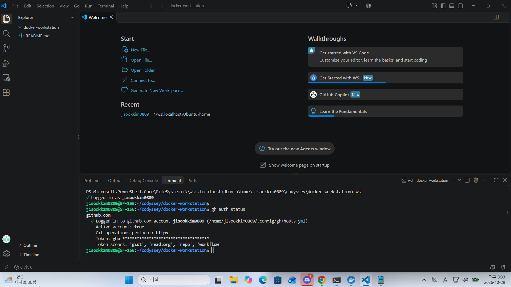
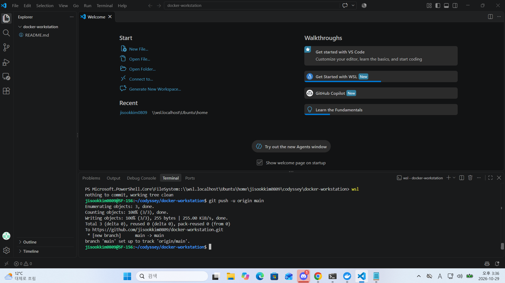
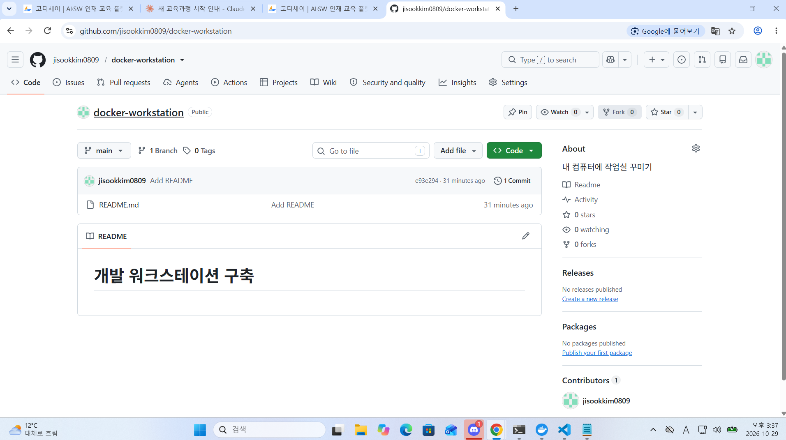

# 개발 워크스테이션 구축

터미널(리눅스 CLI), Docker, Git/GitHub을 직접 세팅하고 검증한 기록입니다.

## 1) 프로젝트 개요

- 목표: 터미널로 작업 환경을 정리하고, Docker로 웹 서버를 컨테이너화하여 포트 매핑·바인드 마운트·볼륨을 검증하고, Git/GitHub으로 결과물을 관리한다.
- 핵심 확인 사항: 이미지와 컨테이너의 분리, 격리된 실행 환경, 포트·스토리지 연결 방식

## 2) 실행 환경

| 항목 | 내용 |
|---|---|
| OS | Windows + WSL Ubuntu (버전: `lsb_release -d` 결과) |
| Shell / Terminal | bash / VS Code 터미널 (WSL: Ubuntu) |
| Docker | (`docker --version` 결과) |
| Git | (`git --version` 결과) |

```bash
$ lsb_release -d
(여기에 출력 붙여넣기)

$ docker --version
(여기에 출력 붙여넣기)

$ git --version
(여기에 출력 붙여넣기)
```

## 3) 수행 체크리스트

- [x] Git 사용자 정보/기본 브랜치 설정
- [x] GitHub 저장소 생성 및 `gh` 로그인, push 연동
- [x] 터미널 기본 조작 (이동/생성/복사/이름변경/이동/삭제)
- [x] 권한 변경 실습 (파일 1개, 디렉토리 1개)
- [ ] Docker 설치/점검 (`docker --version`, `docker info`)
- [ ] Docker 기본 운영 명령 (images, ps, logs, stats)
- [ ] hello-world / ubuntu 컨테이너 실행
- [ ] Dockerfile 기반 커스텀 이미지 빌드/실행
- [ ] 포트 매핑 접속 (8080, 8081)
- [ ] 바인드 마운트 반영 확인
- [ ] 볼륨 영속성 검증
- [ ] VS Code GitHub 연동 증거

## 4) 수행 로그 및 검증

### 4-1. Git 설정

```bash
$ git config --list
(여기에 출력 붙여넣기)
```

### 4-2. GitHub 로그인 및 저장소 연동

```bash
$ gh auth status
(여기에 출력 붙여넣기 - 토큰은 gho_**** 로 가려진 상태 그대로)

$ git push -u origin main
(여기에 출력 붙여넣기)
```

- 증거 이미지:





### 4-3. 터미널 기본 조작 로그

```bash
$ pwd
(출력)

$ mkdir -p ~/codyssey/practice
$ cd ~/codyssey/practice
$ touch empty.txt
$ echo "hello" > a.txt
$ ls
(출력)

$ cat a.txt
(출력)

$ ls -la
(출력: 숨김 파일 포함 목록)

$ cp a.txt b.txt
$ mv b.txt c.txt
$ mkdir dir1
$ mv c.txt dir1/
$ ls dir1
(출력)

$ rm dir1/c.txt
$ rmdir dir1
$ ls
(출력)
```

### 4-4. 권한 실습 (변경 전/후)

파일:

```bash
$ ls -l a.txt
(변경 전 출력, 예: -rw-r--r--)

$ chmod 600 a.txt
$ ls -l a.txt
(변경 후 출력, 예: -rw-------)

$ chmod 644 a.txt
$ ls -l a.txt
(원복 출력)
```

디렉토리:

```bash
$ ls -ld testdir
(변경 전 출력, 예: drwxr-xr-x)

$ chmod 700 testdir
$ ls -ld testdir
(변경 후 출력, 예: drwx------)

$ chmod 755 testdir
$ ls -ld testdir
(원복 출력)
```

### 4-5. Docker 설치 및 점검

```bash
$ docker --version
(출력)

$ docker info
(출력 - 길면 핵심 부분 발췌)
```

### 4-6. Docker 기본 운영 명령

```bash
$ docker pull nginx:alpine
$ docker images
$ docker run -d --name web nginx:alpine
$ docker ps
$ docker logs web
$ docker stats --no-stream
$ docker stop web
$ docker rm web
(각 출력 붙여넣기)
```

### 4-7. 컨테이너 실행 실습

```bash
$ docker run hello-world
(출력)

$ docker run -it --name my-ubuntu ubuntu bash
root@...:/# ls
root@...:/# echo "hi from container"
root@...:/# exit
(출력)
```

attach와 exec 차이 관찰 메모:

- (직접 관찰한 내용을 2~3줄로 작성)

### 4-8. 커스텀 이미지 (Dockerfile)

- 선택한 베이스: `nginx:alpine`
- 커스텀 포인트와 목적:
  - `LABEL`: (목적)
  - `ENV APP_ENV=dev`: (목적)
  - `COPY app/ /usr/share/nginx/html/`: (목적)

```dockerfile
(Dockerfile 내용 붙여넣기)
```

```bash
$ docker build -t my-web:1.0 .
(출력)
```

### 4-9. 포트 매핑 접속

```bash
$ docker run -d -p 8080:80 --name my-web-8080 my-web:1.0
$ curl http://localhost:8080
(출력)

$ docker run -d -p 8081:80 --name my-web-8081 my-web:1.0
$ curl http://localhost:8081
(출력)
```


### 4-10. 바인드 마운트

```bash
(실행 명령 + 호스트 파일 변경 전/후 curl 결과)
```

### 4-11. Docker 볼륨 영속성

```bash
(볼륨 생성 → 컨테이너 연결 → 데이터 기록 → 컨테이너 삭제 → 새 컨테이너로 데이터 확인)
```

## 5) 개념 정리

- **절대 경로 vs 상대 경로:** (예시 포함 2~3줄)
- **파일 권한 r/w/x, 755/644:** (예시 포함 2~3줄)
- **포트 매핑이 필요한 이유:** (2~3줄)
- **Docker 볼륨:** (2~3줄)
- **Git vs GitHub:** (2~3줄)

## 6) 트러블슈팅 (2건 이상)

### 사례 1: sudo 비밀번호 인증 실패

- 문제: `sudo apt update` 실행 시 비밀번호 인증이 반복 실패
- 원인 가설: 설정한 비밀번호와 입력한 값이 다름
- 확인: (실제 확인한 내용)
- 해결: (실제 해결 방법)

### 사례 2: git push 시 인증 요구

- 문제: `git push` 시 Username/Password를 요구
- 원인 가설: WSL 안의 Git에 GitHub 인증 정보가 없음
- 확인: (실제 확인한 내용)
- 해결: `gh auth login`으로 브라우저 인증 후 push 성공

### 사례 3 (선택): `ls -1`과 `ls -l` 혼동

- 문제: 권한 확인 시 권한 정보가 출력되지 않음
- 원인 가설: 옵션이 숫자 1이었음
- 해결: 소문자 `l`로 다시 실행
